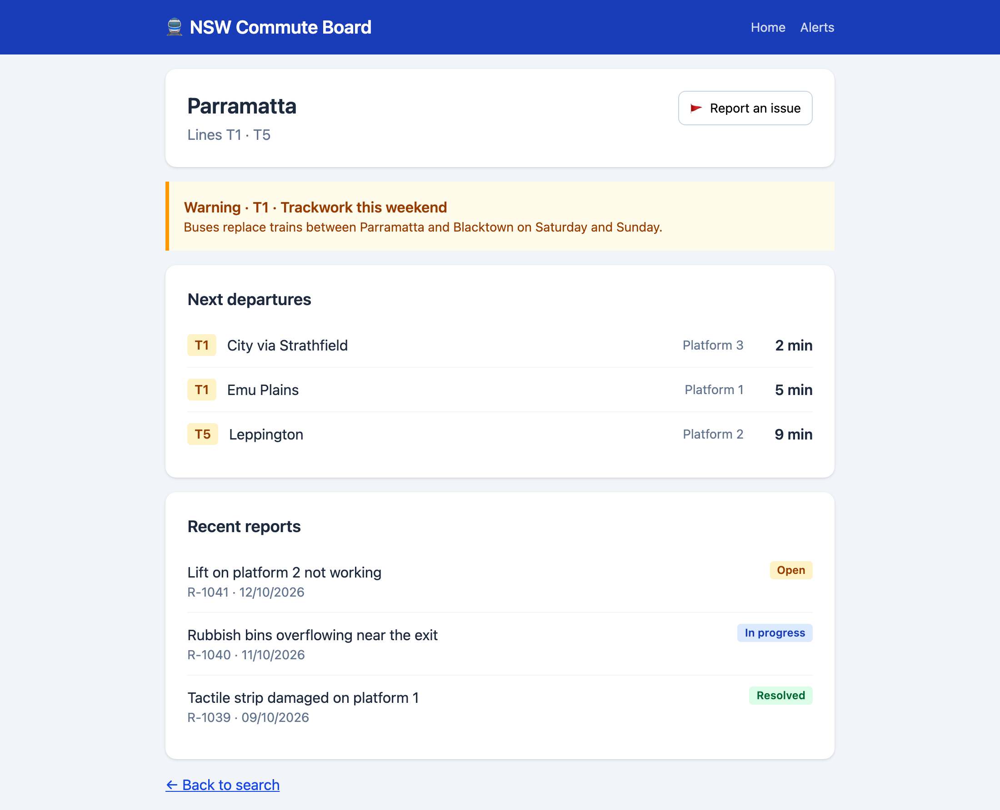
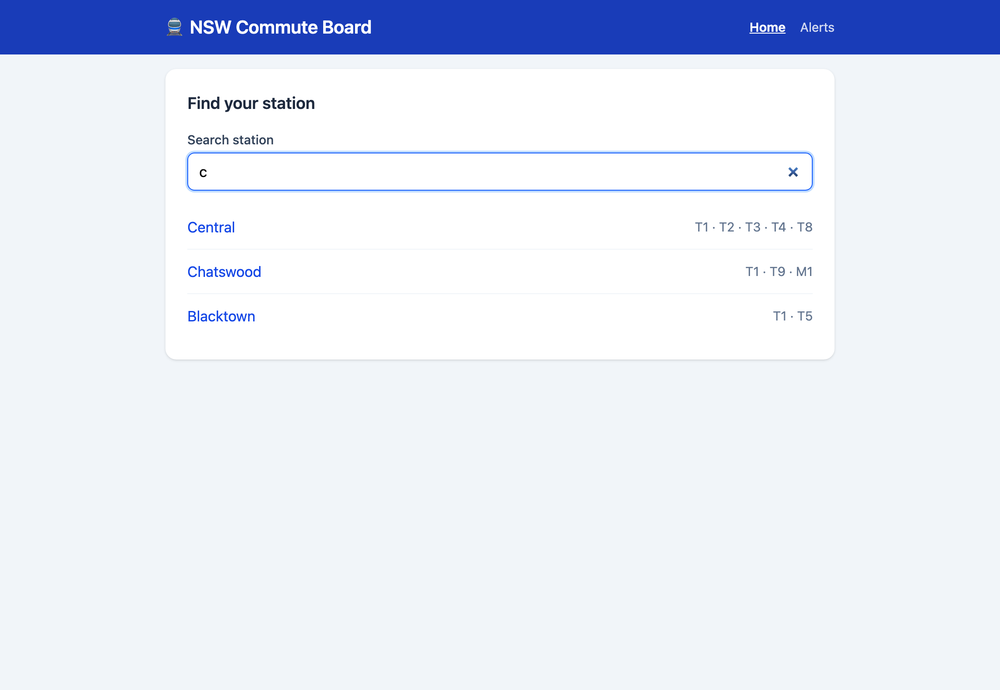
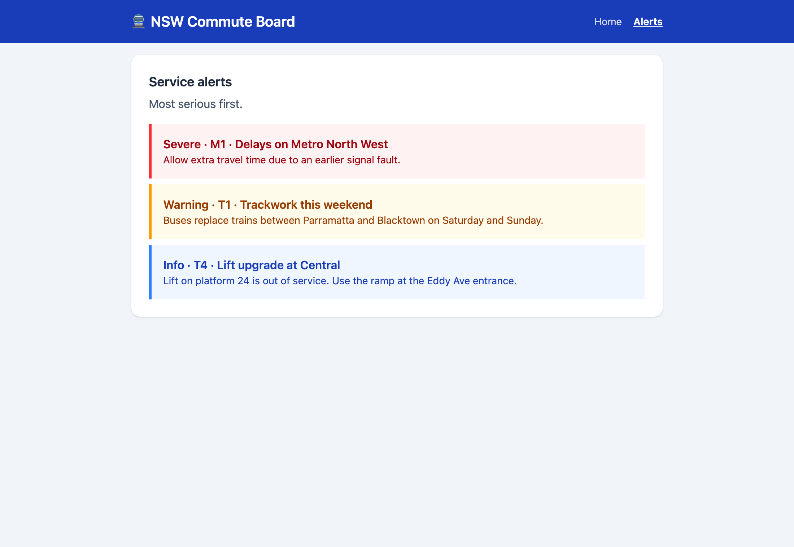
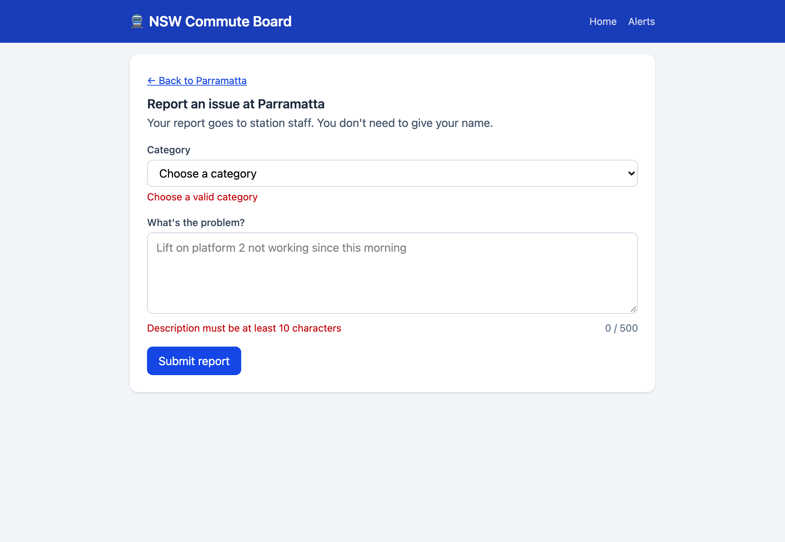
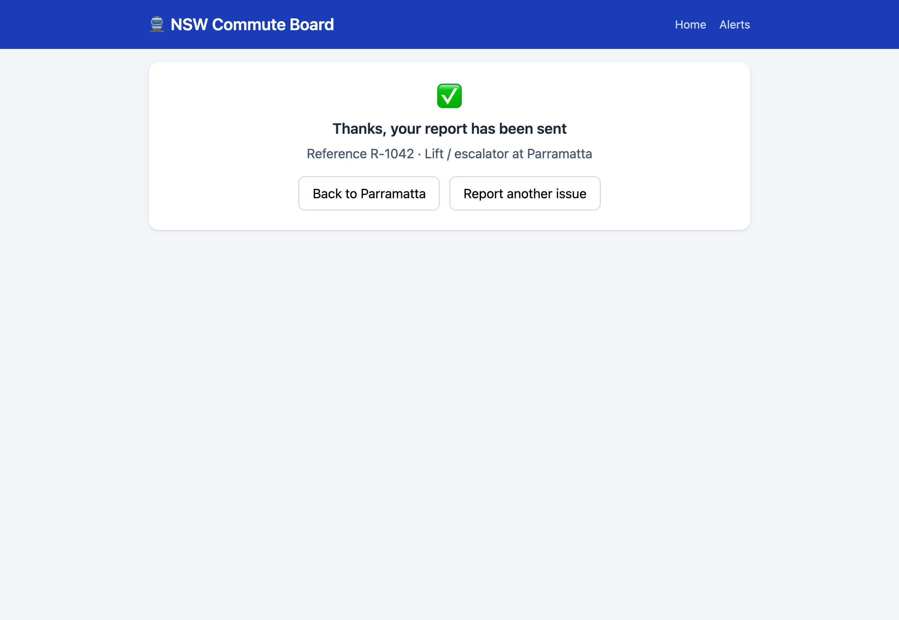

# 🚆 NSW Commute Board

A commuter web app for Sydney trains: search stations, see upcoming departures, check service alerts and report station issues.

Built as a portfolio project with **React + TypeScript** on the frontend and a **Node.js + Express REST API** on the backend.

**Note:** This is a personal portfolio project, not an official Transport for NSW product. It uses sample data for demonstration. Station and line names are used for realism only.

---

## The scenario

Priya commutes from Parramatta to the city every weekday. Each morning she wants to know:

1. **When's my next train, and from which platform?**
2. **Is anything disrupted on my line today?**
3. **Can I report a problem at the station** (like a broken lift) quickly?

NSW Commute Board answers these on one simple screen.

## Features

| Feature | Description | Status |
|---|---|---|
| 🔍 Station search | Find a station by typing part of its name (case-insensitive) | ✅ Done |
| 🕒 Departures | Next trains with line, destination, platform and minutes away | ✅ Done |
| ⚠️ Service alerts | Colour-coded by severity, filtered to each station's lines, plus an all-alerts page | ✅ Done |
| 🛠️ Report an issue | Accessible form with field-level errors from server-side validation, a reference number on success, and recent reports with their status on each station page | ✅ Done |
| ⭐ Favourites | Save stations for quick access (stored in the browser) | Planned |

## Screenshots

**Station page:** departures, alerts for the station's lines, and recent issue reports



| Station search | Service alerts |
|---|---|
|  |  |

| Report form: server validation errors | Report sent with a reference number |
|---|---|
|  |  |

## Tech stack

| Area | Technology |
|---|---|
| Frontend | React 19, TypeScript, Vite, React Router, Tailwind CSS, axios |
| Backend | Node.js, Express 5, TypeScript |
| Testing | Vitest (unit tests ✅) · Playwright (end-to-end tests ✅) · React Testing Library, Supertest *(planned)* |
| Code quality | ESLint, Prettier (`npm run format`), TypeScript strict mode |
| Database | In-memory sample data now, PostgreSQL *(planned)* |

---

## Architecture

```
Browser (React app)
   │  axios → /api/...
   ▼
Vite dev server ── proxies /api ──▶ Express API (port 4000)
                                      middleware → routes → services → repositories → data
```

### Backend layers

| Layer | Folder | Responsibility |
|---|---|---|
| Middleware | `middleware/` | Checkpoints before routes run (e.g. validating new reports) |
| Routes | `routes/` | HTTP only: read the request, send the response and status code |
| Services | `services/` | Business rules (e.g. most severe alerts first, 404 for unknown stations) |
| Repositories | `repositories/` | Data access. The only layer that changes when PostgreSQL is added |
| Validation | `validation/` | Pure validation rules, easy to unit test |
| Models | `models/` | TypeScript types shared across layers |

### Frontend structure

| Folder | Responsibility |
|---|---|
| `pages/` | One component per route (Home, Station, Report an issue, Alerts, Not found) |
| `components/` | Reusable UI pieces (layout and nav bar, `AlertCard` shared by the Station and Alerts pages, `ReportList`) |
| `services/` | API calls with axios. Components never call URLs directly |
| `models/` | TypeScript types matching the API's JSON |
| `utils/` | Small pure functions (e.g. filtering alerts by line), easy to unit test |

### Design decisions

- **Repository pattern:** all data access goes through repositories, so switching from sample data to PostgreSQL only changes one layer.
- **Validation as middleware:** invalid reports are rejected with `400` before reaching the route. Input is sanitised, so users can't set their own `id` or `status`.
- **Request body typed as `unknown`:** TypeScript forces validation before the data is used.
- **Vite proxy in development:** the browser only talks to one origin, matching a typical production setup behind a reverse proxy.
- **CORS restricted to a known origin** (from `.env`), never open to all websites.
- **Errors handled in routes** for clarity at this size. A central error handler would suit a larger API.

---

## Project structure

```
nsw-commute-board/
├── client/                    React frontend
│   └── src/
│       ├── components/
│       ├── models/
│       ├── pages/
│       ├── services/
│       └── utils/
├── server/                    Express API
│   ├── src/
│   │   ├── data/              sample data (seed)
│   │   ├── middleware/
│   │   ├── models/
│   │   ├── repositories/
│   │   ├── routes/
│   │   ├── services/
│   │   ├── validation/
│   │   ├── app.ts             builds the Express app
│   │   └── index.ts           starts the server
│   ├── tests/                 unit tests (Vitest)
│   ├── requests.http          API examples (VS Code REST Client)
│   └── .env.example
├── e2e/                       end-to-end tests (Playwright)
├── playwright.config.ts       starts both servers for e2e tests
├── docs/screenshots/          README screenshots
└── README.md
```

---

## Getting started

### Prerequisites
- Node.js 20 or later
- npm

### 1. Clone and install

```bash
git clone <your-repo-url>
cd nsw-commute-board
```

```bash
cd client && npm install && cd ..
```

```bash
cd server && npm install && cd ..
```

### 2. Set up environment variables

The server reads its settings from `server/.env`. Copy the example file:

```bash
cp server/.env.example server/.env
```

| Variable | Example | Description |
|---|---|---|
| `PORT` | `4000` | Port the API listens on |
| `CORS_ORIGIN` | `http://localhost:5173` | The frontend address allowed to call the API from a browser |

> ⚠️ `.env` is not committed to git. Never put real secrets in `.env.example`.

### 3. Run the app

Start the API (terminal 1):

```bash
cd server && npm run dev
```

Start the frontend (terminal 2):

```bash
cd client && npm run dev
```

Open http://localhost:5173

### 4. Run the tests

```bash
cd server && npm test
```

The report validation rules are covered by unit tests: valid input, length boundaries, whitespace-only descriptions, unknown categories and stations, multiple errors at once, and a missing request body.

**End-to-end tests** (Playwright) run in a real browser. From the project root:

```bash
npm install
```

```bash
npx playwright install chromium
```

```bash
npm run test:e2e
```

Playwright starts both servers automatically (or reuses them if already running). The tests cover the full commuter journey (search → station → report an issue → see it listed) and check that server validation errors appear under each form field. Add `--headed` to watch the browser.

> 📋 See [`e2e/README.md`](e2e/README.md) for all Playwright commands: UI mode, headed, debug, reports and traces.

---

## API endpoints

| Method | Endpoint | Description | Responses |
|---|---|---|---|
| GET | `/api/health` | Health check | 200 |
| GET | `/api/stations?search=par` | Search stations by name | 200 |
| GET | `/api/stations/:id` | Get one station | 200, 404 |
| GET | `/api/stations/:id/departures` | Upcoming departures, soonest first | 200, 404 |
| GET | `/api/alerts` | Service alerts, most severe first | 200 |
| GET | `/api/reports?stationId=parramatta` | Issue reports, newest first | 200 |
| POST | `/api/reports` | Create an issue report | 201, 400 |

### Example: create a report

```http
POST /api/reports
Content-Type: application/json

{
  "stationId": "parramatta",
  "category": "lift",
  "description": "Lift on platform 2 not working"
}
```

**201 Created**

```json
{
  "id": 1042,
  "stationId": "parramatta",
  "category": "lift",
  "description": "Lift on platform 2 not working",
  "status": "open",
  "createdAt": "2026-10-13T08:40:00.000Z"
}
```

**400 Bad Request** (all problems returned at once)

```json
{
  "errors": {
    "stationId": "Station not found",
    "category": "Choose a valid category",
    "description": "Description must be at least 10 characters"
  }
}
```

Validation rules: `stationId` must exist, `category` must be one of `lift`, `cleanliness`, `safety`, `accessibility`, `other`, and `description` must be 10–500 characters.

> 💡 Every endpoint has a ready-to-run example in [`server/requests.http`](server/requests.http). Open it in VS Code with the **REST Client** extension and click **Send Request**.

---

## Roadmap

- [x] React + TypeScript + Vite setup with Tailwind and React Router
- [x] Express API with layered architecture
- [x] Report validation middleware with input sanitising
- [x] Station search page connected to the API
- [x] Loading and error states
- [x] Station page with departures and alerts for its lines
- [x] Alerts page with a reusable `AlertCard` component
- [x] Report an issue form with server validation errors shown per field
- [x] Recent reports on the station page
- [ ] Favourites
- [ ] Request logger and rate limiter middleware
- [x] Unit tests for report validation (Vitest)
- [x] End-to-end tests with Playwright (search → station → report an issue)
- [ ] Component and API tests
- [ ] PostgreSQL database
- [ ] GitHub Actions CI
- [ ] Single `npm run dev` command for both apps

## Author

Thilini Yatanwala